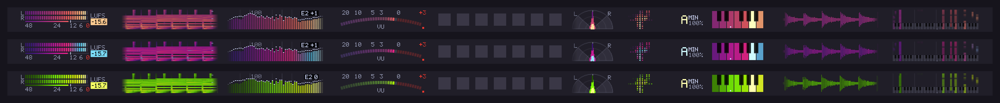
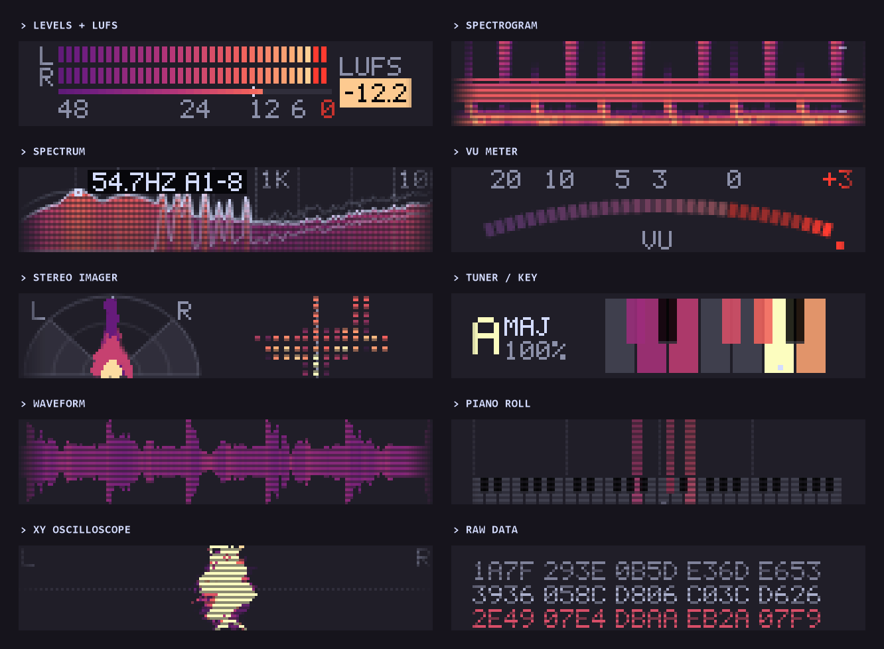
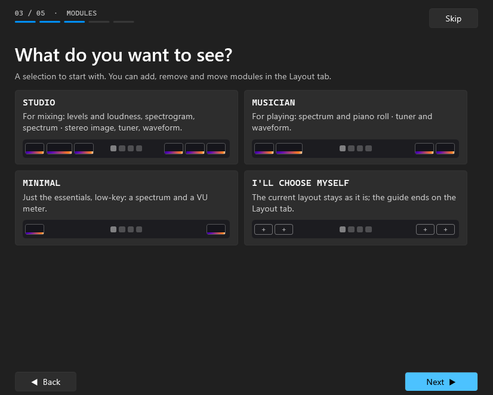
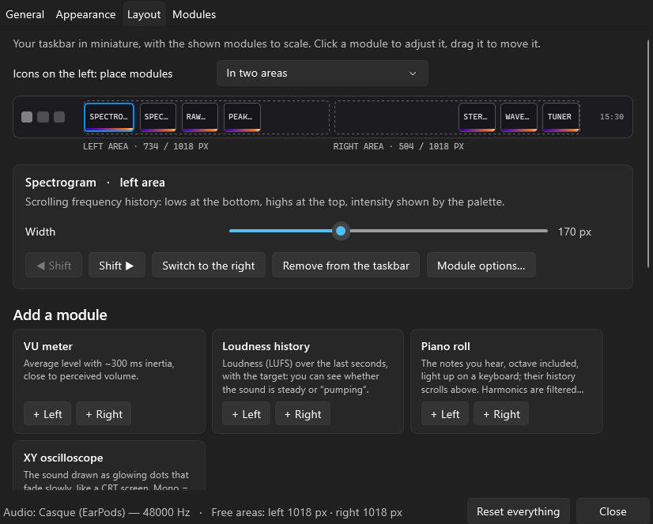

# TaskbarVisu

*English · [Français](README.fr.md)*

**Audio visualizers living inside the Windows 11 taskbar.** No window, no frame: tiny lab-grade meters
drawn straight into the empty space on each side of your icons, in a dot-matrix / y2k / test-equipment style.



```
> CAPTURE ........ WASAPI: the whole PC, one output, ONE APP (process loopback) or an input
> RENDER ......... SkiaSharp into layered Win32 windows, click-through, ~0.55 ms per frame
> FOOTPRINT ...... ~4 % of one core at 60 fps, ~0 % in silence, ~35 MB of private memory
> LAYOUT ......... auto-detects the taskbar (top/bottom, compact, DPI, left-aligned icons) and widgets like FluentFlyout
> SCREENS ........ main screen, a chosen one, or every taskbar at once
```

## Modules



| | |
|---|---|
| **Levels + LUFS** | segmented L/R peak meter, peak hold, clip, BS.1770 loudness with target |
| **Spectrogram** | scrolling frequency history, coloured by intensity |
| **Spectrum** | MiniMeters-style relief (smooth curve shaded by level, stereo side trace), bars, LED dots, filled curve or line; held peaks, peak readout (level, frequency, note) |
| **VU meter** | LED arc or analogue needle, ~300 ms ballistics, mono or stereo |
| **Stereo imager** | polar vectorscope by band + panorama/width per frequency, phase correlation |
| **Tuner / key** | note + cents, or the song's key on a mini piano (English, solfège or Camelot), with key history |
| **Waveform** | mirror, envelope or triggered oscilloscope |
| **Loudness history** | LUFS over 15 s to 5 min against your target |
| **Piano roll** | the notes actually played, octave included, on a 3–6 octave keyboard with scrolling history: dedicated two-resolution FFT, peaks accurate to a few cents, harmonics sieved out |
| **XY oscilloscope** | goniometer or Lissajous drawn in phosphor that fades like a CRT |
| **Raw data** | the samples as your sound card sees them, in scrolling hex or a bit matrix. Purely experimental |

The *Layout* page shows your taskbar in miniature, modules to scale: click one to set its width, drag it
to reorder or switch sides, or group them all in the middle when your icons are left-aligned. Each module
can use the global palette, another palette, its own gradient or a solid colour. On launch they run a
short LED *self-test* before going live.

On first launch a 5-step guide lights up the free areas on your real taskbar, lets you pick a look and a
module pack (Studio, Musician, Minimal, or an empty taskbar to fill yourself), then points at the tray icon.
Replay it from *Home* or *General*.



## Key detection that knows when to shut up

- **Only sustained music counts.** Peaks must stay put from one block to the next: speech glides, coughs
  have no stable peaks, notification sounds are too short. Silent Discord call → `--`.
- **Harmonics are subtracted**, low to high, before anything is shown in the piano roll: a 5th harmonic
  never becomes a fake major third.
- **Modal songs get the truth, not a coin flip.** When a track sits on another note than its scale's tonic,
  the tuner says so: `B♭ MAJ ◆F MIX` = notes of B♭ major, resting on F (Mixolydian).
- Unsure major/minor shows as `MAJ?` / `MIN?` instead of a confident wrong answer.
- Checked against a permanent test bench (real samples, full songs referenced on Tunebat/Hooktheory/Beatport,
  synthetic songs, chords, speech and noise): see [tests/key-bench.csv](tests/key-bench.csv).

## Settings



One-click presets (Lab, MiniMeters-like, CRT Phosphor, Synthwave, Vaporwave, Chrome Y2K, Toxic, RGB,
and hardware looks: VFD, LCD, Nixie), 16 palettes including RGB, a colour animation for any palette
(scroll up or down, one colour at a time, back and forth, breathing pulse; 0.2 to 60 s per cycle), custom
gradients of 2 to 8 colours (global or per module), real colour picker, pixel or smooth font, scanlines,
per-module options tucked behind *More options*. UI in English, French, Spanish and German (follows Windows).

The window looks like Windows 11 Settings: a side menu (Home, Appearance, Layout, Modules, General), and
every setting is a card with an icon and a one-line explanation. *Home* shows what is playing, the free
space on the taskbar, hide / pause buttons, one-click styles and the modules currently shown.

- **My styles**: save the current colours and effects under a name and get them back in one click
  (Appearance and Home pages); the *⋯* menu updates, renames, copies or deletes a saved style.
- **Share a style** as a short `TBV1:…` code (paste it on Discord) or a `.tbvstyle` file.
- **Listen to one app only**: FL Studio without Discord, a game without your music, or a mic/line input.
- **Global hotkey** (Ctrl + Alt + V by default) hides / shows the visualizers, even in games.
- **Built-in updates**: checks GitHub releases, one click installs the new version and restarts.

## Download

Grab the latest build on the [Releases](../../releases) page:

- **Installer** `TaskbarVisu-x.y.z-setup.exe`: per-user install (no admin rights), Start menu entry,
  clean uninstall, in-app updates.
- **Portable** `TaskbarVisu-x.y.z-portable.zip`: one self-contained `.exe`, nothing to install.
  The `portable.txt` next to it keeps the settings in a `data` folder beside the exe (USB stick);
  delete it to use `%APPDATA%\TaskbarVisu` instead.

Windows 11 x64, horizontal taskbar. The binaries are not code-signed, so SmartScreen may show
*Unknown publisher*: click *More info → Run anyway*.

## Build

.NET 10 SDK:

```
dotnet run --project src/TaskbarVisu -c Release
```

Full release (self-contained exe, portable zip, Inno Setup 6 installer, SHA-256 sums and winget
manifests in `build/`, nothing is published):

```
powershell -ExecutionPolicy Bypass -File tools/build-release.ps1
```

Detailed technical documentation (DSP, test bench, diagnostics flags) is in [README.fr.md](README.fr.md) (French).

## License

[GPL-3.0](LICENSE). Uses [NAudio](https://github.com/naudio/NAudio) (MIT) and
[SkiaSharp](https://github.com/mono/SkiaSharp) (MIT). Inspired by MiniMeters; not affiliated with it.
